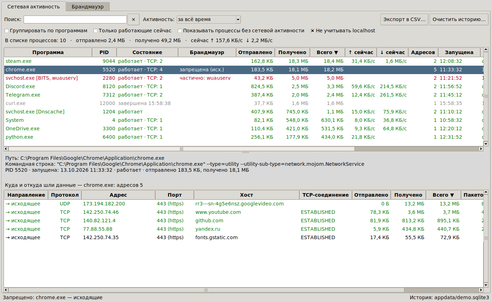
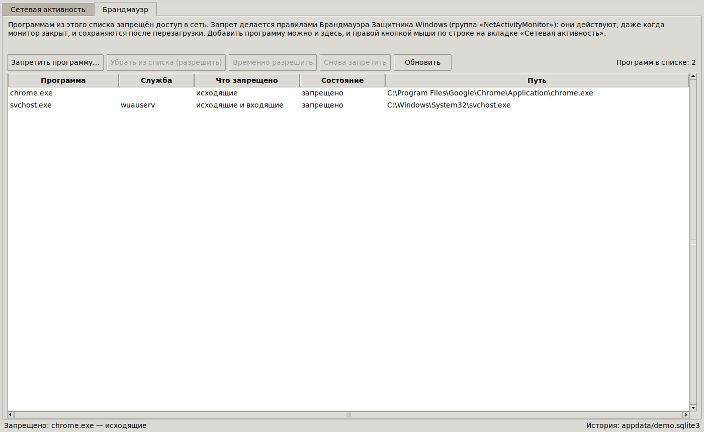

# Сетевая активность программ (Windows)

Версия 1.4 (`python main.py --version`). Что менялось — в разделе [«История версий»](#история-версий).

Программа на Python показывает, какие программы в Windows работали и работают
с сетью, сколько байт каждая отправила и получила и с какими адресами
(и хостами) шёл обмен. История сохраняется, так что видны и программы,
которые уже закрылись.

Ненужным программам можно **запретить доступ в сеть**: на вкладке «Брандмауэр»
ведётся список запретов, программы можно добавлять в него и убирать.

Сторонние библиотеки не нужны: только стандартный Python (ctypes, tkinter, sqlite3).



## Что видно

**Верхняя таблица — программы (процессы):**
- имя, PID, для `svchost.exe` — какие службы в нём работают (`svchost.exe [BITS, wuauserv]`);
- работает или завершена (и когда), когда запущена;
- запрещён ли ей доступ в сеть (колонка «Брандмауэр»);
- сколько байт отправлено и получено за всё время наблюдения;
- текущая скорость ↑/↓;
- сколько разных адресов было, число открытых TCP-соединений;
- путь к exe; в панели ниже — командная строка.

**Нижняя таблица — куда и откуда шли данные у выбранной программы:**
- направление: `→ исходящее` (программа подключалась сама) или `← входящее`
  (к ней подключались на её порт);
- протокол (TCP/UDP), IP-адрес, порт (с подсказкой: `443 (https)`, `53 (dns)`…);
- **хост**: имя, которое программа сама запрашивала у DNS (например,
  `api.github.com`), а если его нет — имя из обратного DNS;
- состояние TCP-соединения, если оно открыто сейчас;
- байты в обе стороны, число пакетов, когда был первый и последний обмен.

Ещё есть:
- **группировка по программам**: все запуски `chrome.exe` в одну строку;
- фильтры «только работающие» и «показывать активные за час / сутки / 7 дней…».
  Период отбирает программы по **последней активности**, а байты в таблице всё равно
  считаются за всё время наблюдения (поминутной истории объёмов программа не хранит);
- поиск по имени, пути, PID, службе, **а также по адресу и хосту**: например,
  по запросу `google` видно, какие программы обращались к Google;
- «Не учитывать localhost»: обмен внутри компьютера не смешивается с интернетом;
- экспорт в CSV (открывается в Excel), контекстное меню (копировать, открыть
  папку программы, «кому принадлежит адрес» на ipinfo.io).

## Требования

- Windows 10 или 11 (Windows 8.1 тоже должна подойти);
- Python 3.8+ с сайта [python.org](https://www.python.org/downloads/windows/)
  (tkinter входит в установщик по умолчанию);
- **права администратора**: без них Windows не отдаёт события сетевого стека.
  Программа сама запросит их через окно UAC.

## Запуск

```bat
cd netmon
python main.py
```

Или двойной щелчок по `NetMon.bat` (без чёрного окна консоли).

Другие режимы:

| Команда | Что делает |
|---|---|
| `python main.py --demo` | демо с выдуманными данными (права администратора не нужны) |
| `python main.py --console` | живая таблица в консоли (запускать в консоли администратора) |
| `python main.py --report` | отчёт по сохранённой истории |
| `python main.py --report --days 7` | отчёт за последние 7 дней |
| `python main.py --help` | все параметры |

## Запрет доступа в сеть (брандмауэр)



**Как запретить:** правой кнопкой мыши по программе на вкладке «Сетевая активность» →
«Запретить доступ в сеть…». Или на вкладке «Брандмауэр» нажмите «Запретить программу…»
и выберите её из списка (или файл `.exe` кнопкой «Обзор…»). Дальше выберите, что запретить:
- **всё**: программа не сможет ни подключаться сама, ни принимать подключения;
- **только исходящие**: программа не сможет ничего отправить сама.

**Как разрешить обратно:** на вкладке «Брандмауэр» выделите программу →
«Убрать из списка (разрешить)» (или клавиша Delete). Кнопка «Временно разрешить» выключает
запрет, не удаляя его; «Снова запретить» включает обратно. Если какое-то из правил успели
удалить вручную (например, в `wf.msc`), «Снова запретить» создаст его заново.

Как это устроено:
- запрет — это обычные правила **Брандмауэра Защитника Windows** в группе
  `NetActivityMonitor`. Они действуют, даже когда монитор закрыт, и сохраняются после
  перезагрузки. Их видно и в стандартной оснастке `wf.msc`;
- `svchost.exe` нельзя запретить целиком: через него работают почти все службы Windows,
  и пропал бы интернет. Запрет ставится на **отдельные службы** (например, `wuauserv`),
  и окно само подставит службы выбранного процесса;
- `System` (PID 4) запретить нельзя: это ядро Windows;
- окно предупреждает об опасных запретах: DNS-клиент, DHCP, `python.exe` и т.п.;
  зарезервированные имена вроде `Any` вместо службы не принимаются: в правиле брандмауэра
  они означают «все службы», то есть весь svchost;
- изменение запрета не начинается с удаления: новые правила сначала создаются
  (или существующие обновляются), а лишние убираются в самом конце. Если Windows откажет
  посередине, прежний запрет останется в силе;
- после каждой команды программа заново читает правила и сверяет их с тем, что должно
  получиться. Если Windows не подтвердила изменение, появится ошибка и описание того, что
  действует на самом деле. Если правила прочитать не удалось, в колонке будет «неизвестно»,
  а не «запрещена». Консольные команды работают по той же схеме.

Что важно знать:
- если брандмауэр Windows выключен или его заменил брандмауэр антивируса, правила
  не действуют. Про выключенный брандмауэр программа предупредит на вкладке;
- соединение, открытое до запрета, иногда живёт до переподключения: если программа
  продолжает обмен, перезапустите её;
- проверяйте запрет действием, которому нужна сеть (например, открыть сайт в запрещённом
  браузере): оно должно перестать работать. То, что у программы перестали расти байты,
  само по себе ничего не доказывает: программа могла просто ничего не отправлять;
- у приложений из Microsoft Store путь меняется после обновления, и запрет придётся
  поставить заново;
- запрет службы срабатывает, только если у службы есть свой SID (у служб Windows обычно есть).
  Если трафик службы не пропал, это тот случай.

Из консоли администратора:

| Команда | Что делает |
|---|---|
| `python main.py --blocked` | список запретов |
| `python main.py --block "C:\Windows\explorer.exe"` | запретить всё |
| `python main.py --block "C:\Windows\explorer.exe" --outbound-only` | запретить только исходящие |
| `python main.py --block "C:\Windows\System32\svchost.exe" --service wuauserv` | запретить службу Windows |
| `python main.py --unblock "C:\Windows\explorer.exe"` | убрать запрет |

## Где хранится история

`%LOCALAPPDATA%\NetActivityMonitor\`:
- `history.sqlite3` — история (по умолчанию хранится 90 дней, параметр `--keep-days`);
- `netmon.log` — журнал (пригодится, если что-то не работает);
- `settings.json` — состояние галочек и размер окна.

Кнопка «Очистить историю…» удаляет всё и начинает счёт с нуля.
Параметр `--no-history` отключает сохранение на диск.

## Как это работает

Данные берутся из **Event Tracing for Windows (ETW)**, из того же источника,
что и у «Монитора ресурсов» Windows:

| Провайдер ETW | Что даёт |
|---|---|
| `Microsoft-Windows-Kernel-Network` | каждая отправка и приём TCP/UDP (IPv4 и IPv6): PID владельца сокета, адреса, порты, число байт |
| `Microsoft-Windows-Kernel-Process` | запуск и завершение процессов: имена даже у программ, которые прожили долю секунды |
| `Microsoft-Windows-DNS-Client` | какие имена процесс разрешал и в какие IP: отсюда колонка «Хост» |

Дополнительно раз в 2 секунды программа читает список процессов и таблицу TCP-соединений
(`GetExtendedTcpTable`). Из неё видны открытые, но молчащие соединения и слушающие порты,
по которым определяется направление «входящее/исходящее».

Файлы:

| Файл | Назначение |
|---|---|
| `main.py` | точка входа, параметры командной строки, запрос прав администратора |
| `etw.py` | сеанс ETW через ctypes, разбор событий (раскладка полей берётся из манифеста через TDH) |
| `winapi.py` | процессы, службы, TCP-таблица, командная строка процессов |
| `model.py` | учёт: процессы → адресаты → байты, привязка DNS-имён |
| `storage.py` | история в SQLite |
| `monitor.py` | рабочий поток: опрос системы, обратный DNS, сохранение |
| `gui.py` / `console.py` | окно (tkinter) и текстовый режим / отчёт |
| `firewall.py` / `fwgui.py` | запреты через Брандмауэр Защитника Windows (PowerShell, модуль NetSecurity) и вкладка «Брандмауэр» |
| `demo.py` | демо-режим |

## Что нужно знать о цифрах

- Считается **полезная нагрузка** TCP/UDP, то есть данные программы без заголовков IP/TCP.
  Поэтому цифры немного меньше, чем показывает счётчик сетевого адаптера.
- Пакеты, которые не принадлежат ни одному сокету (ICMP/ping, ARP, трафик драйверов VPN
  и виртуальных машин), здесь не видны.
- Трафик служб Windows идёт от `svchost.exe`; в скобках видно, какие именно службы там работают.
- `System` (PID 4) — трафик ядра: общие папки (SMB), HTTP.sys и т.п.
- Если браузер использует собственный «DNS поверх HTTPS», его запросы не проходят через
  DNS-клиент Windows. Тогда имя хоста берётся из обратного DNS, и это бывает имя
  CDN-сервера, а не сайта.
- При огромном потоке событий (гигабитная загрузка) часть событий может потеряться:
  счётчик «потеряно» есть в строке состояния.
- Статистика собирается только пока программа запущена. Что было до запуска, узнать нельзя.
- Windows повторно использует номера процессов (PID). Чтобы трафик и сведения не
  приписывались чужому процессу, монитор различает экземпляры по времени запуска
  и по полному пути к exe. События с опозданием тоже относятся к тому экземпляру,
  который тогда жил. Неоднозначен только редкий случай: PID достался новому процессу
  меньше чем через 0,25 с после завершения прежнего, и пакет нового процесса пришёл
  раньше события о его запуске. Тогда этот пакет засчитается прежнему процессу:
  данные завершённого процесса ядро тоже ещё недолго досылает от его имени.
- У UDP нет соединений, поэтому «входящее/исходящее» для него угадывается по портам.
- Адреса IPv6 вида `fe80::…` на разных сетевых картах считаются одним адресом:
  события ETW не сообщают номер интерфейса.

## Если что-то не работает

- «Сбор статистики не работает: отказано в доступе» — запустите от имени администратора.
- Байты не растут, хотя есть трафик: попробуйте `python main.py --no-etw-filter` и пришлите
  `netmon.log` из папки истории.
- «Монитор уже запущен» — второй экземпляр, даже в другом сеансе Windows (другой
  пользователь, удалённый рабочий стол), сломал бы первому сбор данных; закройте первый.
- Запрет не создаётся: текст ошибки покажется в окне. Подробности есть в `netmon.log`.

## Собрать .exe (по желанию)

```bat
pip install pyinstaller
pyinstaller --onefile --windowed --uac-admin --name NetMon main.py
```

Готовый `dist\NetMon.exe` сразу запрашивает права администратора.

## Тесты

```bat
python -m unittest discover -s tests
```

Тесты проверяют разбор событий ETW (на синтетических данных), раскладку структур
Windows (x64), учёт трафика, историю, разбор TCP-таблицы и правила брандмауэра.
Скрипты PowerShell для брандмауэра прогоняются через настоящий PowerShell
(`pwsh` или путь в переменной `NETMON_PWSH`) с подменёнными командлетами; без PowerShell
эти 8 тестов пропускаются. Тесты можно запускать и не в Windows, но настоящую работу
ETW и брандмауэра они не заменяют: её нужно проверять в Windows.

## История версий

**1.4**
- Новый процесс, получивший PID сразу после завершения прежнего (даже через сотые доли
  секунды), больше не теряется: у него своя запись, и его трафик не засчитывается
  завершённому. Так же — если о прежнем знали только по трафику или по снимку процессов.
- Запоздавшее событие о запуске относится к той записи, чей это запуск, даже если с тем же
  PID уже работает следующий процесс, и не создаёт лишнюю запись.
- Запуск сверяется со временем создания процесса, если Windows его уже сообщила.

**1.3**
- PID сменил владельца, а exe с тем же именем лежит в другой папке
  (`C:\Old\app.exe` и `C:\Other\app.exe`): теперь это разные программы, и трафик
  прежней не переходит к новой. Тот же exe, запущенный заново почти сразу, тоже
  отличается — по времени создания.
- Новый запуск с тем же PID, когда событие о завершении прежнего процесса потерялось
  или пришло позже, создаёт отдельную запись, а не сливается с прежней.
- Запоздавший пакет относится к процессу, в чьё время жизни он точно попал, а не
  к соседнему «с запасом».
- Время событий ETW берётся по тем же системным часам, что и время запуска процессов,
  поэтому сравнения не уходят со временем (раньше часы QPC расходились с ними).
- Сетевые пути `\Device\Mup\…` показываются как `\\сервер\ресурс\…`.

**1.2**
- Ошибка чтения правил брандмауэра (например, нет доступа) больше не выглядит как
  «правил нет»: состояние становится «неизвестно», а «Убрано из списка» не пишется,
  пока правила на самом деле не исчезли.
- «Снова запретить» восстанавливает правила, удалённые вручную, и сообщает об успехе,
  только когда действуют все нужные правила.
- Если PID быстро достался другой программе (даже за доли секунды), её путь и время
  запуска не приписываются прежнему процессу, а его трафик — новому.
- Запоздавшие события ETW старого и нового процесса с одним PID не смешиваются,
  даже если у них совпадают адреса и порты.
- Появился номер версии: заголовок окна, `--version`, журнал, отчёт.

**1.1**
- Брандмауэр: изменение запрета не начинается с удаления; после каждой команды правила
  перечитываются и сверяются; при сбое — «неизвестно», а не «запрещена»; имена служб
  вроде `Any` не принимаются.
- Экземпляры процессов различаются по времени запуска; запоздавшие события ETW
  относятся к тому экземпляру, который тогда жил.
- Приём UDP: адреса в событии переставлены — теперь это учитывается.
- Второй экземпляр монитора (в том числе в другом сеансе Windows) не запускается.
- История: сбой записи не оставляет дублей; сохраняется время последней активности.

**1.0**
- Монитор сетевой активности по событиям ETW, история в SQLite, отчёт и текстовый режим.
- Запрет доступа в сеть через Брандмауэр Защитника Windows.
